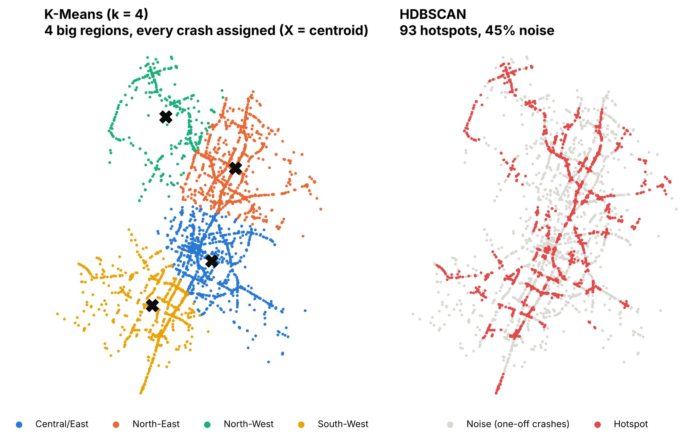
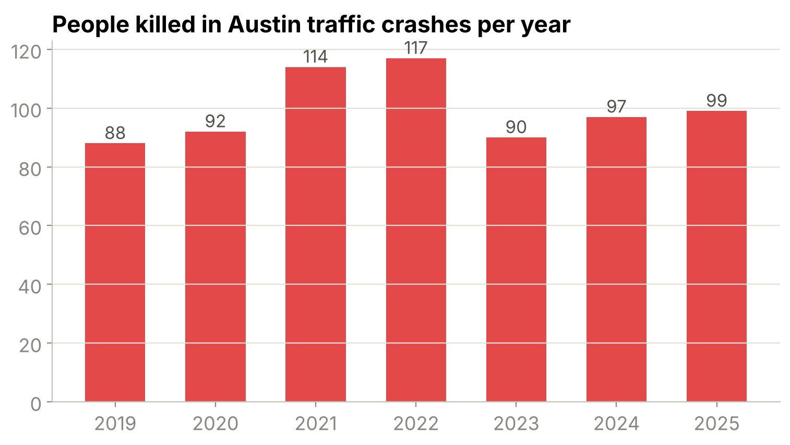
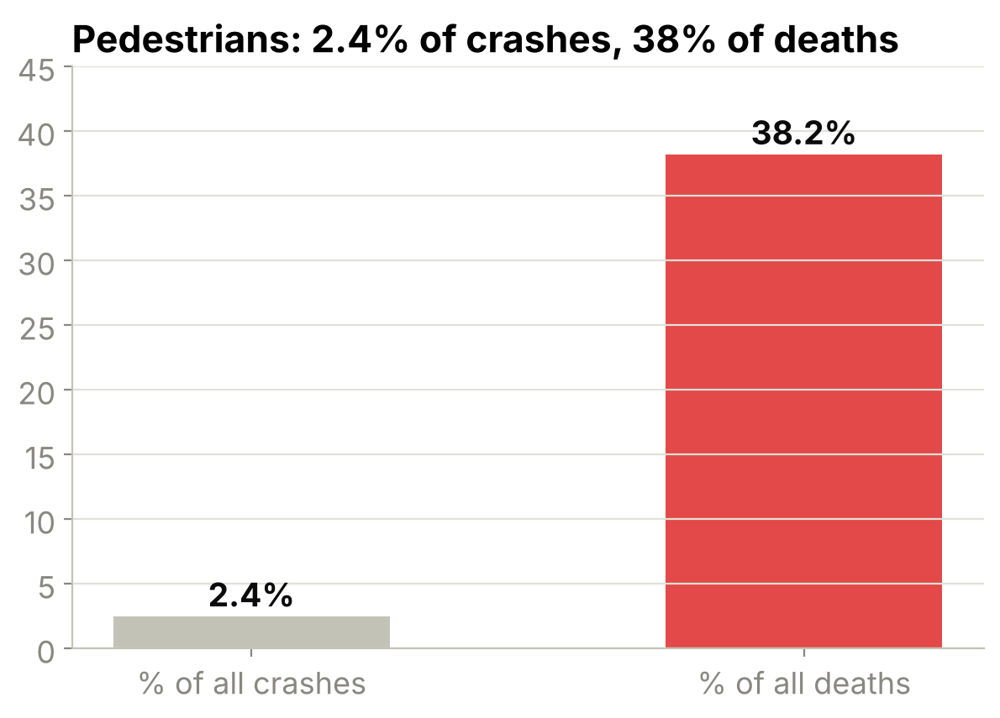
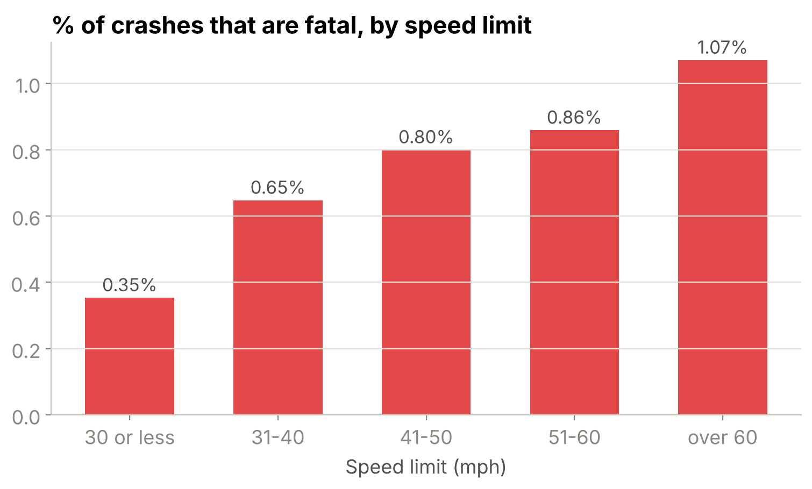
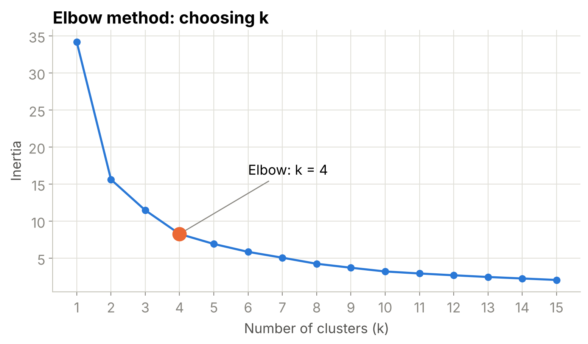
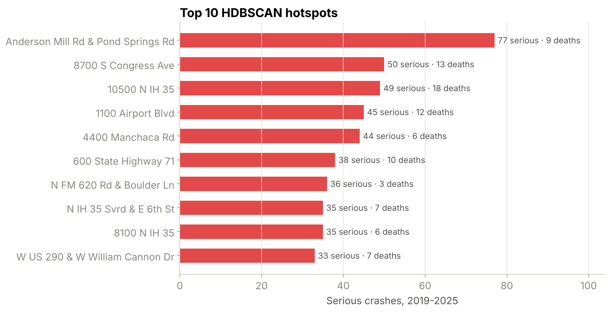

# Austin Crash Hotspots: Clustering Analysis (K-Means vs HDBSCAN)

**Where do serious crashes keep happening in Austin?** I used clustering on 7 years of City of Austin crash data to find the most dangerous places, comparing **K-Means** and **HDBSCAN**.



---

## The problem

Austin's **Vision Zero** goal is zero traffic deaths, but about **100 people still die on Austin roads every year** (697 deaths from 2019–2025). Out of 93,403 crashes in that period, **3,474 (3.7%) killed or seriously injured someone**. The city can't fix every road at once, so it needs to know **where** serious crashes keep happening.



## Data

- **Source:** [Austin Crash Report Data – Crash Level Records](https://data.austintexas.gov/Transportation-and-Mobility/Austin-Crash-Report-Data-Crash-Level-Records/y2wy-tgr5), City of Austin Open Data Portal
- **Raw data:** 235,632 crash records (2010–2026)
- **Used:** 93,403 crashes from 2019–2025, with 28 crashes without a location dropped
- **Clustered:** the 3,474 **serious** crashes (someone killed or seriously injured)

## What I did

1. **Data cleaning:** converted dates, kept 7 full years, picked the columns I needed, dropped missing locations, and created a `serious` column
2. **Exploratory analysis:** deaths per year, pedestrian risk, and speed limit vs. crash severity
3. **K-Means:** clustered serious crashes by latitude and longitude, and used the elbow method to choose k = 4
4. **HDBSCAN:** clustered the same crashes with `min_cluster_size=10`, to find crowded spots and label one-off crashes as noise
5. **Comparison:** compared K-Means vs. HDBSCAN and turned the results into recommendations

## Key findings

**1. Pedestrians are 2.4% of crashes but 38% of deaths.** When a pedestrian is involved, 31% of crashes are serious, compared with 3% otherwise (10× more dangerous).



**2. Speed doesn't change how often a crash is serious, but it changes how often it's deadly.** The serious rate is 3–4% at every speed limit, but the fatal rate **triples**, from 0.35% (30 mph or less) to 1.07% (over 60 mph).



**3. K-Means (k = 4)** split Austin into 4 regions. North-East had the most serious crashes (1,167) and deaths (264), but each region covers about **767 addresses**, which is too big to act on.



**4. HDBSCAN found 93 hotspots** (about 18 addresses each), mostly stretches of major roads like N IH-35, S Congress Ave and Airport Blvd. **55% of serious crashes happen in hotspots**, and the other 45% are scattered one-off crashes (noise).

**5. The top 10 hotspots alone hold about 13% of serious crashes and deaths.**



## K-Means vs HDBSCAN

| | K-Means (k = 4) | HDBSCAN |
|---|---|---|
| Number of groups | 4 regions | 93 hotspots |
| Avg. addresses per group | ~767 | ~18 |
| % of crashes in a group | 100% | 55% |
| Separates one-off crashes? | No, every crash is assigned | Yes, 45% labeled noise |
| Must choose number of groups? | Yes (elbow method) | No |
| Cluster shape | Round blobs | Any shape (follows roads) |

**K-Means** was useful for a high-level view of which part of the city has the most serious crashes. But it forces every crash into a group and makes regions too big to act on. **HDBSCAN** finds the places where crashes crowd together, so its hotspots are specific roads the city can fix.

## Recommendations

1. **Hotspot approach (55% of serious crashes):** start with the top 10 HDBSCAN hotspots. These are specific roads where engineers can redesign intersections, add signals and improve crossings.
2. **Systemic approach (45%, the noise):** these crashes don't repeat at one spot, so they need city-wide changes such as lower speed limits on fast roads, better street lighting and safer pedestrian crossings.
3. **Focus on pedestrians and speed:** pedestrians are 38% of deaths, and crashes on roads over 60 mph are 3× more likely to be fatal.

## Limitations and next steps

- **No traffic volume:** busy roads have more crashes partly because more cars use them. Next, I'd add traffic counts to compare crashes per car.
- **Not every crash is reported:** minor crashes, especially with pedestrians or bikes, may never reach the police.
- **Results depend on settings:** `min_cluster_size=10` gave 93 hotspots. Next, I'd test 5 and 20 to check that the top hotspots stay the same.
- **Where, not why:** clustering shows where crashes happen, not why. Next, I'd study road design, lighting and speeding at the top hotspots.

## Tools

Python · pandas · NumPy · matplotlib · scikit-learn (KMeans, HDBSCAN) · Jupyter Notebook

## How to run

1. Download the data as CSV from the [Austin Open Data Portal](https://data.austintexas.gov/Transportation-and-Mobility/Austin-Crash-Report-Data-Crash-Level-Records/y2wy-tgr5) (Export → CSV). Rename it to `austin_crashes.csv` and put it in the `data/` folder.
2. Install the packages (scikit-learn 1.3 or newer is needed for HDBSCAN):
   ```
   pip install pandas numpy matplotlib scikit-learn
   ```
3. Open `Austin_Crash_Hotspots_Analysis.ipynb` and run all cells.

## Project structure

```
Austin_Crash_Hotspots_Project/
├── notebooks/
│   └── Austin_Crash_Hotspots_Analysis.ipynb
├── data/
│   ├── serious_crashes_kmeans.csv
│   ├── serious_crashes_clustered.csv
│   └── hdbscan_hotspots.csv
│   └── serious.csv
│   └── austin_crashes_clean.csv
├── images/
└── README.md
```
## Disclaimer

This is an independent portfolio project using publicly available City of Austin data. It is not an official City of Austin analysis or a deployed cluster analysis system.
